> [!CAUTION]
> The only official places to download SwiftTunnel are this GitHub repository and [swifttunnel.net](https://www.swifttunnel.net/download). Any other website offering downloads or claiming to be us is not ours.

<p align="center">
  <picture>
    <source media="(prefers-color-scheme: dark)" srcset="docs/readme/logo-dark.png">
    
  </picture>
</p>

<h1 align="center">SwiftTunnel</h1>

<p align="center"><strong>Lower ping. Pure signal.</strong><br>A performance app built only for Roblox.</p>

<div align="center">

[![Version][badge-release]][latest]
[![Downloads][badge-downloads]][releases]
[![Platform][badge-platform]][download]
[![Discord][badge-discord]][discord]
[![License][badge-license]](LICENSE)

[Download][download] · [Test your ping][ping] · [Server status][status] · [Tutorials][tutorials] · [Discord][discord]

</div>

<p align="center">
  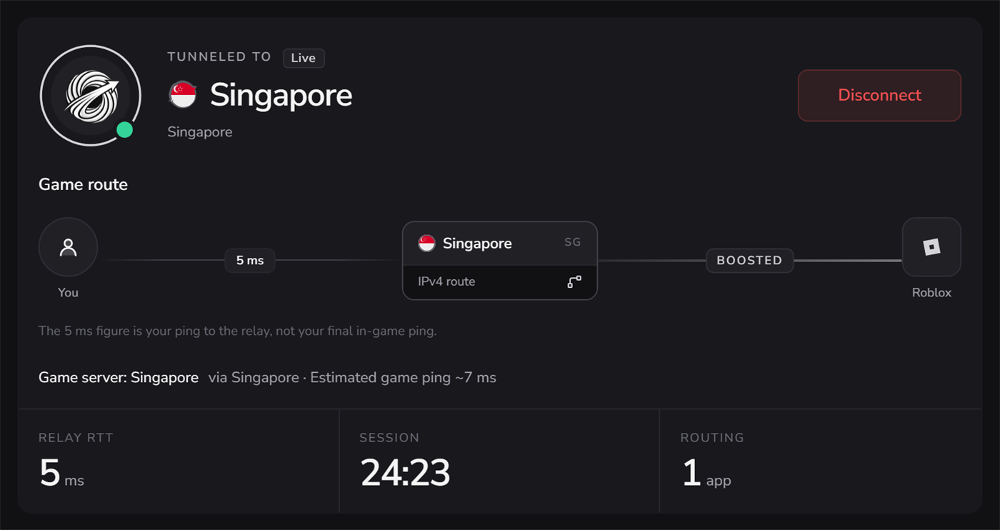
</p>

SwiftTunnel sends your Roblox traffic through a relay right next to the Roblox server you're playing on, so it takes a cleaner path than your internet provider's default route. Everything else on your PC stays on your normal connection.

Around that, it covers the rest of playing Roblox well: choosing servers by location, FPS and graphics per game, a FastFlags editor, a live in-game overlay, and Windows tuning you can always undo.

> [!NOTE]
> SwiftTunnel runs on **Windows 10 and 11**, on both x64 and ARM64 PCs.

<picture>
  <source media="(prefers-color-scheme: dark)" srcset="docs/readme/diagram-route-dark.png">
  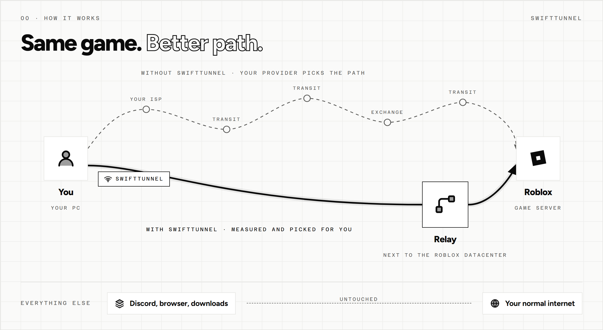
</picture>

## Frequently asked questions

<details>
<summary><b>Is it safe?</b></summary>
<br>

Yes. The source code is public, every installer is built by our GitHub release workflow and carries a build attestation you can verify yourself (see [Security](#security)), and the app only installs updates with a valid signature. Just make sure you download it from an official source.
</details>

<details>
<summary><b>Can using this get me banned?</b></summary>
<br>

SwiftTunnel doesn't inject anything into Roblox or touch the game while it runs. It changes the network route your Roblox traffic takes, and it edits Roblox's own settings files: the same files the in-game settings menu and launchers like Bloxstrap write. The FastFlags editor only allows flags Roblox itself supports.
</details>

<details>
<summary><b>Is it a VPN?</b></summary>
<br>

No. A VPN sends all of your traffic through someone else's server. SwiftTunnel only moves Roblox, and only to give it a better route. It doesn't hide your IP from websites.
</details>

<details>
<summary><b>Will it lower my ping?</b></summary>
<br>

For most players, yes, but it depends on your internet provider's routes. The [ping test][ping] shows your own numbers to every relay before you install anything.
</details>

<details>
<summary><b>Does it work with Bloxstrap, Fishstrap or Voidstrap?</b></summary>
<br>

Yes, keep using your launcher. SwiftTunnel can import your supported settings from it.
</details>

<details>
<summary><b>Why does it need administrator rights?</b></summary>
<br>

Keeping Roblox separate from the rest of your traffic needs a network driver, and the optimizations change Windows settings. Both need administrator rights.
</details>

<br>

<picture>
  <source media="(prefers-color-scheme: dark)" srcset="docs/readme/banner-routing-dark.png">
  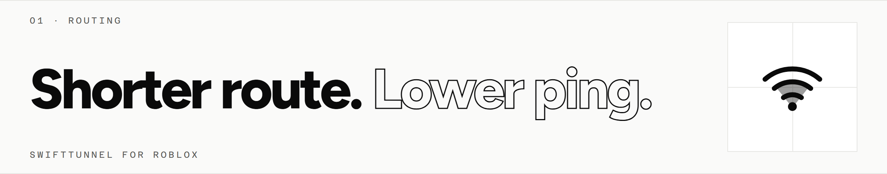
</picture>

- **Automatic relay choice.** SwiftTunnel spots which Roblox server you joined and switches to the relay with the best route to it.
- **Pick your own** relay whenever you prefer, and SwiftTunnel keeps it.
- **Ping before you connect.** Every location shows an estimated ping up front, and you always see which relay you're on.
- **Split tunneling.** Only Roblox goes through the relay. Discord, your browser and your downloads stay on your normal internet.
- **Country-ban bypass.** If Roblox is blocked on your network or in your country, SwiftTunnel can carry it through a relay so you can still sign in and play.

<br>

<picture>
  <source media="(prefers-color-scheme: dark)" srcset="docs/readme/banner-games-dark.png">
  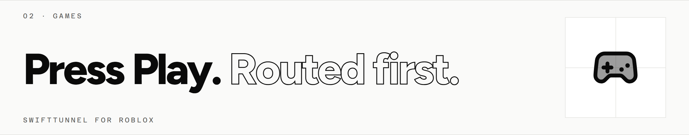
</picture>

<p align="center">
  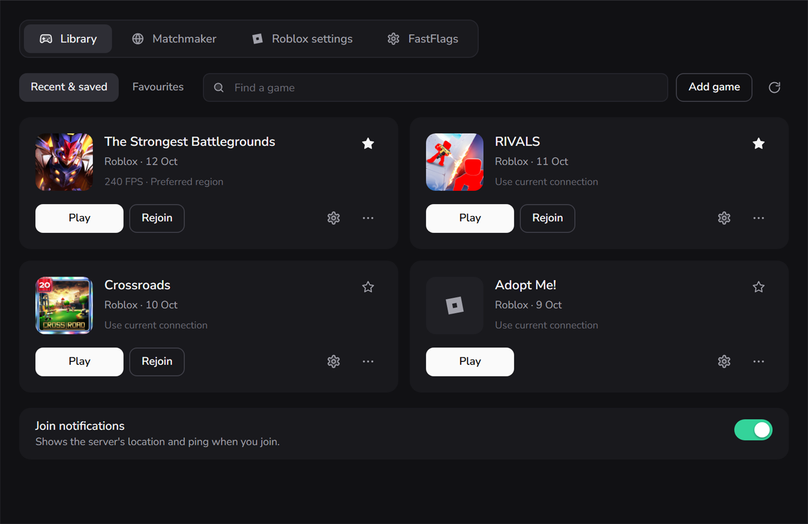
</p>

- Your Roblox games in one place, with favourites, shortcuts, rejoin and the last four games you played.
- **One-press Play.** SwiftTunnel connects the right relay first, then launches Roblox straight into the game.
- Keep a preferred location for each game, or choose **Play in any location** for the fastest join.
- **Roblox VNG** is supported too.

What happens when you press Play:

```text
  ┌───────────────────┐
  │  Press Play       │   on any game in your library
  └─────────┬─────────┘
            ▼
  ┌───────────────────┐
  │  Matchmaker       │   picks a public server in a city you allow (optional)
  └─────────┬─────────┘
            ▼
  ┌───────────────────┐
  │  SwiftTunnel      │   connects the relay for that server
  └─────────┬─────────┘
            ▼
  ┌───────────────────┐
  │  Roblox           │   opens straight into the game
  └───────────────────┘
```

<br>

<picture>
  <source media="(prefers-color-scheme: dark)" srcset="docs/readme/banner-matchmaker-dark.png">
  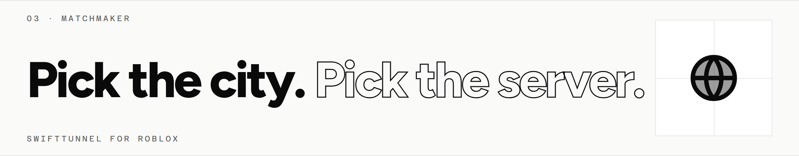
</picture>

<p align="center">
  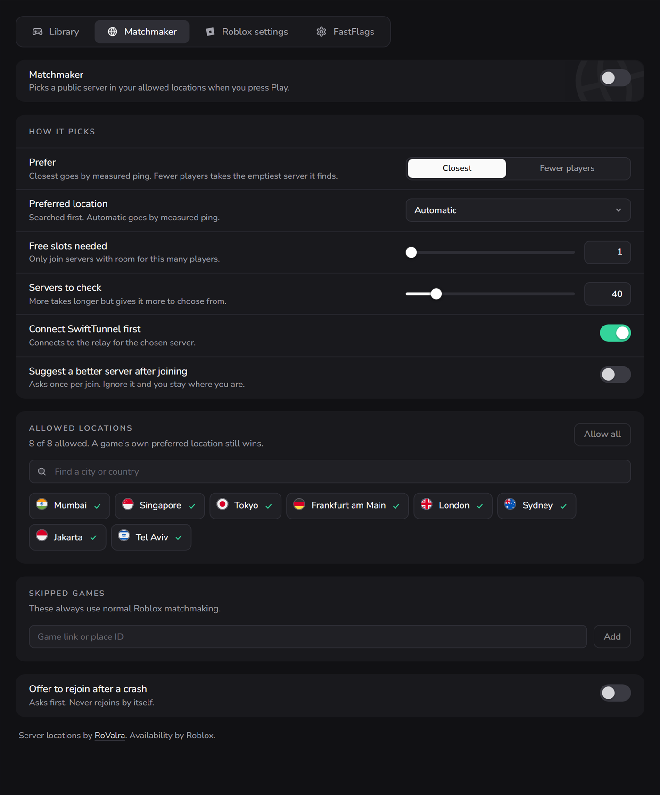
</p>

- Choose the Roblox datacenter cities you're happy to play in.
- Let Matchmaker pick the **closest** server by ping, or the one with the **fewest players**.
- Ask for free slots so your friends can join, and browse public servers by location before you join.

<br>

<picture>
  <source media="(prefers-color-scheme: dark)" srcset="docs/readme/banner-roblox-dark.png">
  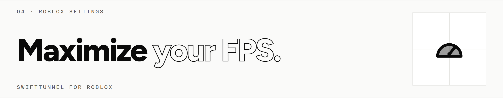
</picture>

<table>
  <tr>
    <td width="50%">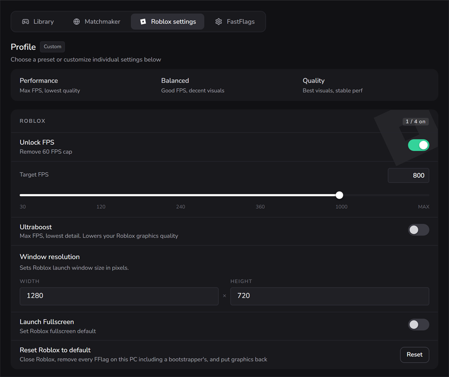</td>
    <td width="50%">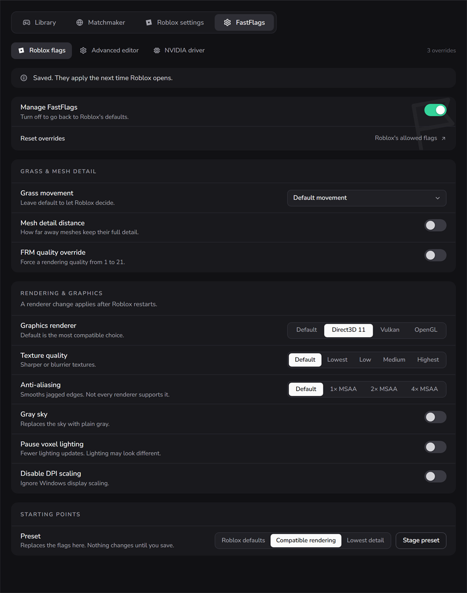</td>
  </tr>
</table>

<p align="center">
  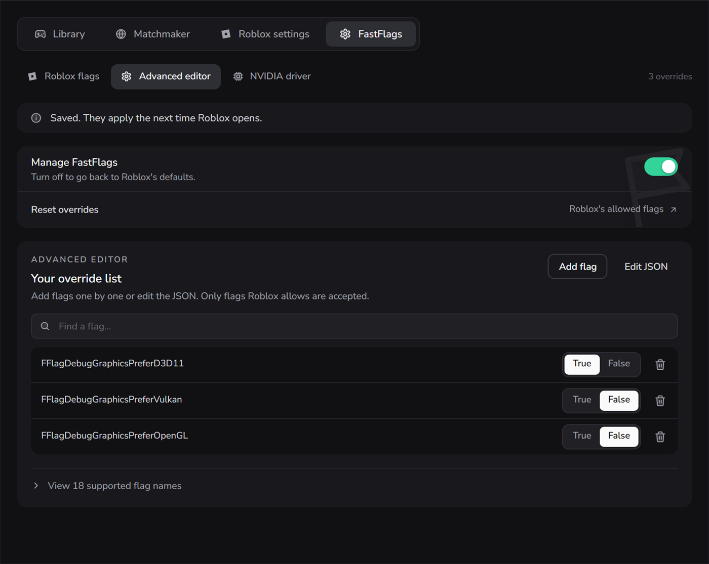
</p>

- **FPS unlock** with a cap you choose, plus graphics, window size and fullscreen.
- **Per-game profiles.** Give each game its own FPS cap and graphics. Your normal settings come back when Roblox closes.
- **FastFlags editor** with simple switches and choices instead of raw JSON, plus an **advanced editor** to add any flag Roblox allows by name or edit the JSON directly.
- **NVIDIA profile** for the Roblox player on compatible NVIDIA GPUs.
- **Ultraboost** for maximum FPS at the lowest detail.
- **Reset Roblox to default** in one press, and **import** settings from other launchers.

<br>

<picture>
  <source media="(prefers-color-scheme: dark)" srcset="docs/readme/banner-overlay-dark.png">
  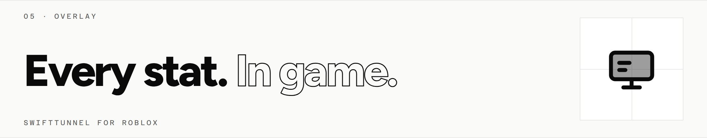
</picture>

<p align="center">
  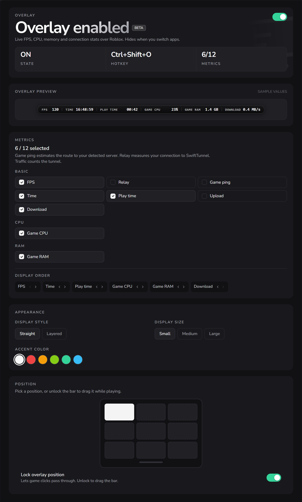
</p>

- Live stats on top of Roblox: **FPS, game ping, relay, play time, Roblox's CPU and RAM, GPU, temperatures, upload, download and the time.**
- Straight or layered, three sizes, six accent colors, and nine positions on screen.
- Toggle it any time with **Ctrl+Shift+O**. It hides itself when you switch to another app.

<br>

<picture>
  <source media="(prefers-color-scheme: dark)" srcset="docs/readme/banner-optimize-dark.png">
  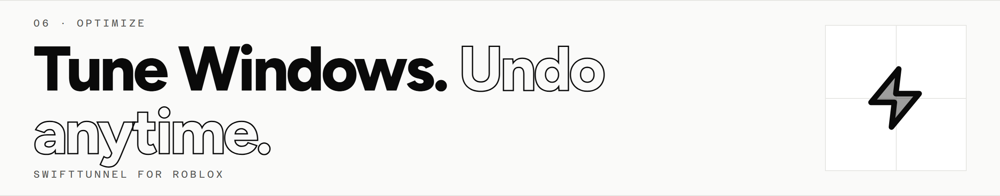
</picture>

<table>
  <tr>
    <td width="50%">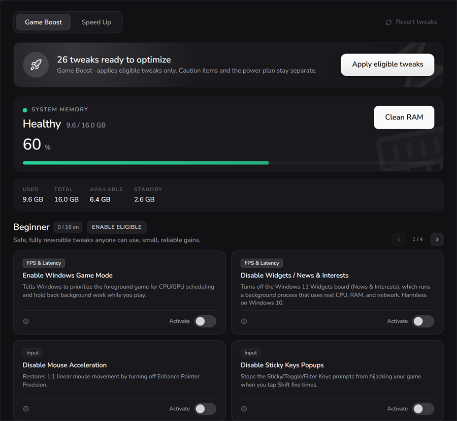</td>
    <td width="50%">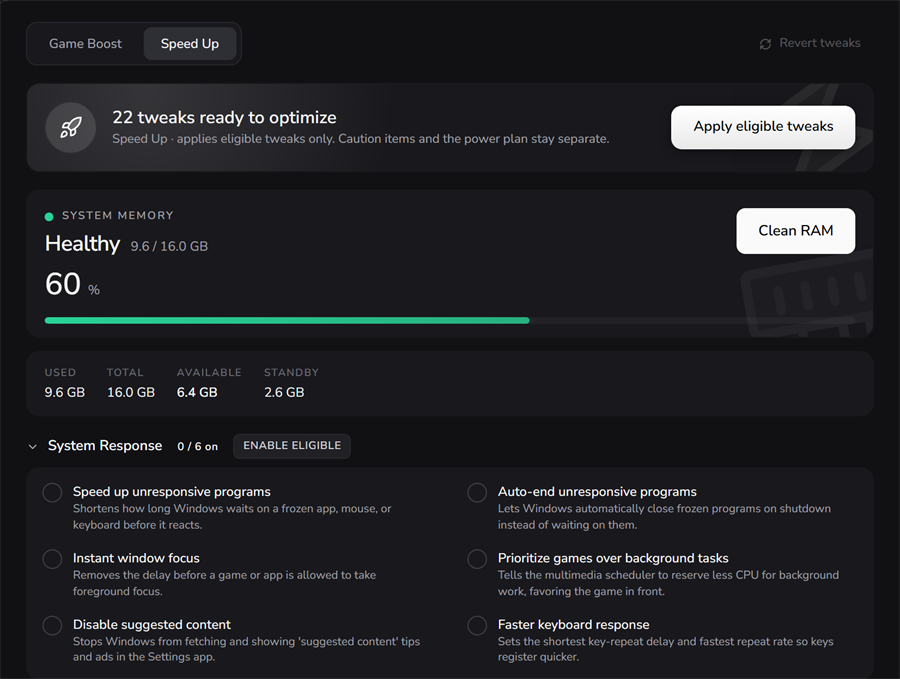</td>
  </tr>
</table>

- **Game Boost** presets in four levels: Beginner, Intermediate, Advanced and Expert.
- **Speed Up** tweaks for System, Performance, System Response, Network, Input, File System, Memory and Cache, Windows Services, Startup and Shutdown, and Privacy.
- **Every tweak can be undone,** individually or all at once.

<br>

## More

- **SwiftTunnel Lite.** A tiny version built natively for Windows, with no browser engine inside. Same relays, the Roblox essentials. Get it from the [download page][download].
- **Updates.** The app keeps itself up to date. Choose **Stable** for vetted releases or **Live** for early builds.

## Download

| Package | Where to get it |
| --- | --- |
| **SwiftTunnel** (recommended) | [swifttunnel.net/download][download], or `SwiftTunnel-Setup-<version>.exe` from the [latest release][latest] |
| **SwiftTunnel Lite** | `SwiftTunnelLite-Setup-<version>.exe` from the same places |
| **MSI packages** | `SwiftTunnel_<version>_x64_en-US.msi` and the `arm64` version, for managed installs |

Run the installer, then sign in with a free SwiftTunnel account.

## Security

- **Signed updates.** The updater only installs releases whose signatures check out.
- **Verifiable builds.** Every installer and update file is built by our GitHub release workflow and carries a build attestation. Check any download with the [GitHub CLI](https://cli.github.com/):

  ```bash
  gh attestation verify SwiftTunnel-Setup-<version>.exe --repo Swift-tunnel/swifttunnel-app
  ```

- **Reversible changes.** Optimizations and Roblox settings can all be undone, and uninstalling puts Roblox back the way it was.

To report a vulnerability, follow [SECURITY.md](SECURITY.md). See also the [privacy policy](https://www.swifttunnel.net/privacy), [terms](https://www.swifttunnel.net/terms) and [trust and safety](https://www.swifttunnel.net/trust) pages.

## Building from source

You'll need Windows 10 or 11, the latest stable [Rust](https://rustup.rs/), [Node.js](https://nodejs.org/) LTS, and Visual Studio Build Tools with the "Desktop development with C++" workload.

```bash
git clone https://github.com/Swift-tunnel/swifttunnel-app.git
cd swifttunnel-app/swifttunnel-desktop
npm ci
npm run tauri:dev     # run the app (from an Administrator terminal)
npm run tauri:build   # build the MSI installer
npm test              # interface tests
cargo test -p swifttunnel-core   # engine tests, from the repo root
```

| Folder | Contents |
| --- | --- |
| `swifttunnel-desktop` | The app: React interface and the Tauri shell |
| `swifttunnel-core` | The Rust engine: tunnel, split tunneling, Roblox tools and optimizations |
| `swifttunnel-lite` | SwiftTunnel Lite |
| `swifttunnel-setup` | The installer you download from the website |
| `release-notes` | What changed in each release |

How the pieces fit together:

```text
  ┌──────────────────────┐      ┌──────────────────────┐
  │ swifttunnel-desktop  │      │ swifttunnel-lite     │
  │ React + Tauri app    │      │ tiny native app      │
  └──────────┬───────────┘      └──────────┬───────────┘
             └──────────────┬──────────────┘
                            ▼
              ┌───────────────────────────┐
              │ swifttunnel-core (Rust)   │
              │ tunnel · split tunneling  │
              │ Roblox tools · optimize   │
              └─────────────┬─────────────┘
                            ▼
    Windows Packet Filter ──► SwiftTunnel relay ──► Roblox
```

The relay server is open source too: [Swift-tunnel/swifttunnel-relay](https://github.com/Swift-tunnel/swifttunnel-relay).

**Built with** [Tauri 2](https://tauri.app/), [React 19](https://react.dev/) and TypeScript for the app, Rust for the engine, [Windows Packet Filter](https://www.ntkernel.com/windows-packet-filter/) for split tunneling, SwiftTunnel's own UDP relay, and WiX for the MSI installer.

## Credits

- Server locations in Matchmaker and the server browser are powered by [RoValra](https://www.rovalra.com).
- Split tunneling runs on [Windows Packet Filter](https://www.ntkernel.com/windows-packet-filter/) by NT KERNEL.

## License

SwiftTunnel is released under the [MIT License](LICENSE).

[latest]: https://github.com/Swift-tunnel/swifttunnel-app/releases/latest
[releases]: https://github.com/Swift-tunnel/swifttunnel-app/releases
[download]: https://www.swifttunnel.net/download
[ping]: https://www.swifttunnel.net/ping
[status]: https://status.swifttunnel.net
[tutorials]: https://www.swifttunnel.net/tutorials
[discord]: https://discord.gg/8FjPxk92Tf

[badge-release]: https://img.shields.io/github/v/release/Swift-tunnel/swifttunnel-app?style=flat-square&label=version&color=0a0b14
[badge-downloads]: https://img.shields.io/github/downloads/Swift-tunnel/swifttunnel-app/total?style=flat-square&color=0a0b14
[badge-platform]: https://img.shields.io/badge/platform-Windows%2010%20%7C%2011-0a0b14?style=flat-square&logo=windows&logoColor=white
[badge-discord]: https://img.shields.io/badge/discord-join-5865F2?style=flat-square&logo=discord&logoColor=white
[badge-license]: https://img.shields.io/github/license/Swift-tunnel/swifttunnel-app?style=flat-square&color=0a0b14
